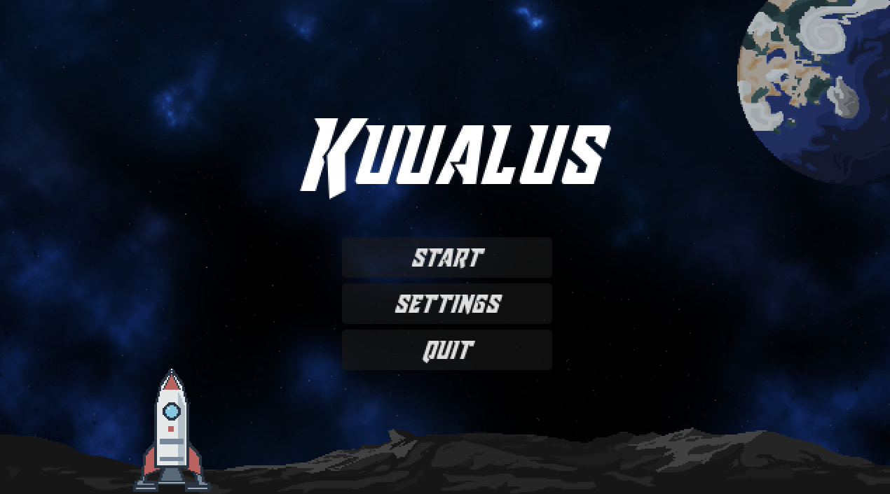
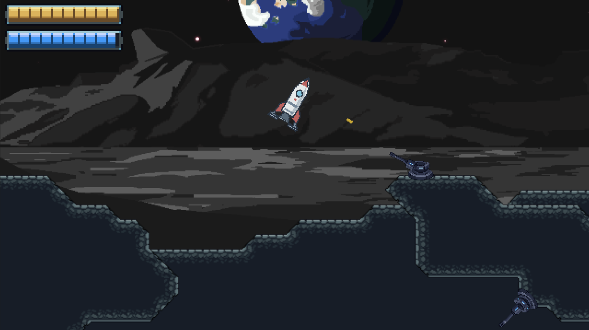

# Kuualus
<p align="center">
  
  
</p>
*Kuualus* is Finnish and means a spacecraft on a mission to the moon, including landing on its surface.
The project is created as the assignment of our group for the module **Introduction to Game Programming**. We are the first group that is not part of the **Game Academy* at the university to develop a game project in this course.
Each group chose of existing arcade games as reference. We decided on **Thrust**, a single player arcade game where you fly a spacecraft in a 2d physics environment and destroy enemy anti-aircraft guns and pick up cargo to collect point to your score.

In our version we use more modern graphic elements and add a landing platform to receive the cargo. Inspired by **SpaceX's Falcon 9** rockets we wanted to implement the satisfying feeling of a landing rocket and combine with nostalgia for the old school classic.


## Debugging
### Custom Start
To start the game in the state you like for debugging, go to GameManager.cs _Ready() and add the ChangeState line:
```C#
ChangeState(GameStateType.InGame, force: true);
```